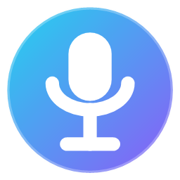

<p align="center"></p>

<h1 align="center">RemoteDictation · 远控听写</h1>

<p align="center">在远程控制画面里，按住输入法语音键说话，松开后文字自动粘贴到远端电脑。</p>

---

## 它解决什么问题

用 Windows 远程控制另一台电脑（比如 Mac）时，本机的语音输入法用不上：

- 远控软件在前台时会接管键盘，按语音键要么没反应，要么被当成普通按键发到远端；
- 就算本机识别出了文字，也是输入到本机，不会进到远端的输入框。

RemoteDictation 让你**一直待在远控画面里**，照常按住输入法的语音键说话，松开后文字自动出现在远端当前的输入框里。**只粘贴，不按回车，不会替你发送。**

## 用起来是这样

1. 在远控画面里点好远端的输入框（聊天框、文档、终端都行）。
2. **按住**语音键（默认读取豆包输入法的设置，比如左 Alt），屏幕下方出现听写浮窗。
3. 说话，说完**松开**。
4. 输入法整理完文字后，自动粘贴到远端，浮窗消失。

其他细节：

- 只是**点一下** Alt、按 **Alt+其他键**、或按住时**点鼠标**，都不算听写，照常发给远端（Mac 上的 Option 组合键不受影响）。
- 说到一半按 **Esc** 取消，文字留在浮窗里，可以改完再点「粘贴到远端」。
- 平时只在托盘运行，空闲时几乎不占 CPU，内存很小。可设置开机自动启动。

## 能用在哪些远控软件上

原理对所有“远控窗口在本机前台、通过剪贴板同步文字”的软件都适用。内置识别以下客户端（按进程名）：

| 远控软件 | 识别的进程名 | 状态 |
| --- | --- | --- |
| ToDesk | `ToDesk` | ✅ 已实测（Windows → Mac） |
| 网易 UU 远程 | `GameViewer` / `UURemote` / `UU_Remote` | 已内置，待反馈 |
| 向日葵 | `SunloginClient` / `AweSun` | 已内置，待反馈 |
| RustDesk | `rustdesk` | 已内置，待反馈 |
| AnyDesk | `AnyDesk` | 已内置，待反馈 |
| TeamViewer | `TeamViewer` | 已内置，待反馈 |
| Parsec | `parsecd` | 已内置，待反馈 |
| Windows 远程桌面 | `mstsc` / `msrdc` | 已内置，待反馈 |
| VNC Viewer / TightVNC | `vncviewer` / `tvnviewer` | 已内置，待反馈 |
| Splashtop | `strwinclt` | 已内置，待反馈 |
| Moonlight | `Moonlight` | 已内置，待反馈 |

不在表里的软件，在 `RemoteDictation.exe` 同目录的 `bridge-settings.json` 里加上它的进程名即可（用任务管理器“详细信息”页看进程名）：

```json
{ "ExtraRemoteProcesses": ["MyRemoteClient"] }
```

远端是什么系统都行（Mac、Windows、Linux），只要远控软件开启了**剪贴板同步**。

### 粘贴键怎么选

程序在本机发出粘贴快捷键，再由远控软件转成远端的按键：

- **远端是 Mac**：看远控软件把哪个键映射成 Command。ToDesk 默认 Ctrl→Command，选 **Ctrl+V**；如果你的软件是 Win→Command，选 **Win+V**。
- **远端是 Windows / Linux**：选 **Ctrl+V**。

### 输入法

默认自动读取**豆包输入法**的“长按语音”快捷键。其他支持“按住某个修饰键说话”的输入法也能用，在设置里把语音键改成对应的左/右 Alt 或左/右 Ctrl 即可。

## 安装

**直接用**：在 Releases 下载 `RemoteDictation.exe`，放到一个固定的文件夹里运行。

**自己编译**（不需要 Visual Studio，Windows 自带编译器即可）：

```powershell
.\build.ps1            # 生成 bin\RemoteDictation.exe
.\bin\RemoteDictation.exe --self-test .\bin\self-test.json   # 可选：跑一遍逻辑自测
```

运行要求：Windows 10/11 x64，.NET Framework 4.8（系统自带）。

### 关于管理员权限（重要）

很多远控软件（例如 ToDesk）是以**管理员权限**运行的。Windows 不允许普通权限的程序读取管理员窗口前台的按键，也不允许向它发送粘贴。所以：

- 第一次请**右键 →“以管理员身份运行”**，然后在设置窗里勾选「**开机自动启动**」。
- 开机自启是通过“任务计划程序”以最高权限启动的（任务名 `RemoteDictation`），之后不会再弹权限提示；以后直接双击 EXE，也会自动转交给这个任务启动。
- 取消：设置窗取消勾选，或运行 `RemoteDictation.exe --autostart off`。

## 原理（为什么要这样做）

这几点都是在真实 ToDesk 环境里抓数据确认的，详见 [docs/原理.md](docs/原理.md)：

1. **远控软件会吞键**：ToDesk 在获得前台时安装自己的低级键盘钩子，把按键拦下来发给远端。比它先装的钩子（包括输入法自己的）都收不到。本程序在远控窗口到前台后重新安装钩子，排到它前面。
2. **输入法不认模拟按键**：豆包只响应真实的物理按键，程序用 SendInput 模拟的语音键会被忽略。
3. **按住 Alt 不会自动重复**：整个按住过程只有一次“按下”。如果先让远控软件收到、再切窗口，输入法就再也等不到这次按下，只能按第二次。
4. **所以在“按下”送达之前就切前台**：在钩子回调里（这次按键还没被派发时）把前台切到本机的听写浮窗，再放行这次按下，输入法就在浮窗里开始听写。
5. **等整理完再贴**：松开后等输入法结束组字、文字 1.5 秒不再变化，再写入剪贴板，回到原远控窗口发出粘贴键。等待期间如果你切走了窗口或又复制了别的内容，就不贴，文字留在浮窗。

## 隐私

- 不录音、不联网、没有任何上传接口；语音识别完全由你本机的输入法完成。
- 不记录你说的内容，也不记录其他按键。
- 设置文件只保存开关和按键选择。诊断日志默认关闭（`"DiagnosticLog": true` 可开启，只记时间、键码和字数）。

## 已知限制

- 只在“Windows 本机 + ToDesk + 豆包输入法 + 远端 Mac”上做过完整实测，其他组合欢迎在 Issues 反馈。
- 远控画面里单独按住语音键超过约半秒会被当成听写；如果你经常在远端单独长按 Option/Alt，可以在托盘里临时暂停。
- 按住 Alt 时点鼠标（Mac 上的 Option+点击）会被当成普通点击。
- 粘贴依赖远控软件的剪贴板同步，同步慢的软件可在设置文件里调大 `TextDelay`（毫秒，默认 800）。

## 致谢

- 参考了 macOS 项目 [DoubaoVoiceBridge](https://github.com/yupeng316888-create/DoubaoVoiceBridge)（MIT）的思路，本项目是独立的 Windows 实现。
- 想法最初来自「生财有术 · 航海家」社群里一次关于远程办公和语音输入的讨论，在此致谢。

与豆包、字节跳动、ToDesk 及表中任何远控软件均无官方关系，相关名称归各自所有者。

## 许可

[MIT](LICENSE)
